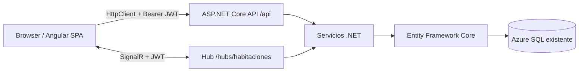

# WEB-AUDIT-01 — Arquitectura de WebClinica

Fecha de corte: 18 de octubre de 2026, zona `America/Guatemala`.

## 1. Arquitectura encontrada

WebClinica es una SPA Angular 18 basada en componentes `standalone`. El arranque se realiza con `bootstrapApplication`; `app.config.ts` registra el router, `HttpClient`, el interceptor JWT y coalescencia de eventos. No utiliza `NgModule`, NgRx ni una biblioteca de componentes distinta de Bootstrap.

La aplicación respeta el límite arquitectónico principal: el frontend no contiene acceso SQL ni se comunica directamente con la base de datos. El backend es la autoridad de autenticación, permisos y reglas de negocio.

## 2. Capas y responsabilidades reales

| Área | Ubicación | Responsabilidad observada | Evaluación |
|---|---|---|---|
| Composición | `WebClinica/src/main.ts`, `src/app/app.config.ts` | Arranque y proveedores globales | Clara y mínima |
| Navegación | `src/app/app.routes.ts` | Layout protegido, rutas lazy y alias | Funcional, con rutas del menú sin destino |
| Núcleo | `src/app/core/` | Guard, interceptor, modelos, servicios y un mock residual | Bien delimitado; contiene deuda desconectada |
| Layout | `src/app/layout/` | Contenedor principal y menú lateral | Adecuado |
| Páginas | `src/app/pages/` | Pantallas por dominio | Coherente, aunque varias plantillas grandes están inline |
| Compartidos | `src/app/shared/` | No existe | No constituye un defecto por sí solo; hay poca reutilización visual |
| Estado | Signals, `computed`, estado local y un `BehaviorSubject` | Sesión, menú y habitaciones | Suficiente para el tamaño actual |
| Contratos | `src/app/core/models/` | Interfaces y DTO TypeScript | Tipado estricto en servicios; persisten tres formularios/filtros con `any` |

## 3. Flujo de navegación

`app.routes.ts` protege el layout completo con `authGuard`. Casi todas las pantallas se cargan de forma lazy con `loadComponent`. `LoginComponent` y `MainLayoutComponent` son las excepciones razonables.

Rutas funcionales:

- `/dashboard`.
- `/pacientes`, alta y edición.
- `/empleados`, alta y edición; `/admin/empleados` funciona como alias.
- `/admin/usuarios`, alta y edición.
- `/historial/:id`, nueva consulta y detalle de consulta.
- `/habitaciones`.
- `/inventario`, medicamentos y lotes; `/medicamentos` funciona como alias.
- `/ventas`, nueva venta y detalle.

Rutas que la API puede enviar y que el router no implementa:

| Ruta de `API-Clinica/Common/MenuCompleto.cs` | Resultado actual |
|---|---|
| `/citas` | Cae en el comodín y redirige a `/dashboard` |
| `/consultas` | Cae en el comodín; el historial solo se abre por paciente |
| `/admin/roles` | Cae en el comodín |
| `/reportes/citas` | Cae en el comodín |
| `/reportes/pacientes` | Cae en el comodín |

Las rutas `/medicamentos` y `/admin/empleados` sí están reconciliadas mediante alias. La incompatibilidad restante está confirmada por `WebClinica/src/app/app.routes.ts:9-175` y `API-Clinica/Common/MenuCompleto.cs:9-99`.

## 4. Formularios y validación

Los formularios son template-driven mediante `FormsModule` y `ngModel`. Se observan restricciones HTML como `required`, límites de longitud, tipos `email`, `number`, `date` y controles deshabilitados durante envíos. La API vuelve a validar las reglas de negocio, como debe hacerlo.

Limitaciones:

- `empleado-form.component.ts:136`, `usuario-form.component.ts:68` y `ventas-list.component.ts:108` usan `any`.
- La conversión de `ProblemDetails` no está centralizada; varias pantallas esperan `err.error.message`, formato que no representa todos los errores de ASP.NET Core.
- Muchos `label` no tienen asociación `for`/`id`; algunos botones de cierre no tienen `aria-label`.
- Los identificadores de sucursal, paciente y rol se solicitan a veces como números libres en vez de catálogos seleccionables.

## 5. Estado y flujos reactivos

- `AuthService` conserva usuario y JWT con Signals y expone `isAuthenticated` como `computed`.
- `MenuService` mantiene el menú filtrado por la API en un Signal y solo elimina elementos `hidden`.
- `HabitacionesService` mantiene la colección en un `BehaviorSubject`; la carga HTTP y los eventos SignalR actualizan la misma fuente.
- Las demás páginas guardan estado local en propiedades del componente y consumen observables de `HttpClient`.

No se detectaron ciclos en el grafo de imports TypeScript alcanzable. Los observables HTTP finalizan por sí mismos. La suscripción persistente del tablero de habitaciones usa `takeUntilDestroyed`. El componente desconectado de movimientos se suscribe a `queryParamMap` sin liberación, pero no participa en el bundle alcanzable.

## 6. Código alcanzable y código desconectado

El grafo desde `src/main.ts`, incluyendo imports dinámicos, contiene 58 archivos TypeScript de producción y deja fuera seis:

| Elemento desconectado | Estado técnico |
|---|---|
| `core/mock/citas.mock.ts` | Mock residual con contratos del módulo pendiente |
| `core/models/cita.model.ts` | Solo lo consume el módulo desconectado |
| `core/services/cita.service.ts` | Archivo vacío, 0 bytes |
| `core/services/cita-realtime.service.ts` | Archivo vacío, 0 bytes |
| `pages/citas/citas-list.component.ts` | Sin ruta; depende de los dos servicios vacíos |
| `pages/inventario/inventario-movimientos.component.ts` | Sin ruta; llama métodos inexistentes en `InventarioService` y usa rutas antiguas `/dashboard/inventario...` |

El verificador analiza el HTML de citas y movimientos, pero el build AOT no compila esos componentes al no estar en el grafo. Por ello, “plantilla válida” no equivale a “módulo integrable”.

## 7. Tamaño y mantenibilidad

Los componentes más grandes son `citas-list.component.ts` (328 líneas, desconectado), `ventas-nueva.component.ts` (268), `consulta-detalle.component.ts` (230), `lotes-medicamento.component.ts` (224), `historial.model.ts` (216), `empleado-form.component.ts` (214), `inventario-list.component.ts` (214) y `habitaciones-board.component.ts` (211). No justifican una reestructuración total, pero `consulta-detalle` y `ventas-nueva` concentran presentación, estado y orquestación suficiente para extraer piezas cuando reciban cambios funcionales.

La consolidación de `PagedResponse` y de los modelos de catálogo evita duplicación importante. No se identificaron servicios activos redundantes ni imports relativos rotos.

## 8. Contrato frontend/API

| Módulo Angular | Servicio | Endpoint API | Método | Compatibilidad | Evidencia |
|---|---|---|---|---|---|
| Sesión | `AuthService` | `/api/auth/login`, `/api/auth/me` | POST, GET | Compatible | `auth.service.ts:27,40`; `AuthController.cs:16,28` |
| Menú | `MenuService` | `/api/menu` | GET | Respuesta compatible; cinco rutas sin pantalla | `menu.service.ts:32`; `MenuCompleto.cs` |
| Pacientes | `PacientesService` | `/api/pacientes` | GET/POST/PUT/DELETE | Compatible estáticamente | `paciente.service.ts:33-61`; `PacientesController.cs` |
| Empleados | `EmpleadosService` | `/api/empleados` | GET/POST/PUT/DELETE | Compatible; valores `Medico`, `Enfermera`, `Administrativo` conservados | `empleado.service.ts`; `EmpleadoDtos.cs` |
| Usuarios | `UsuariosService` | `/api/usuarios` | GET/POST/PUT/DELETE | Compatible estáticamente | `usuarios.service.ts:21-37`; `UsuariosController.cs` |
| Catálogos | `CatalogosService` | `/api/sucursales`, `/especialidades`, `/turnos` | GET | Compatible, pero solo primera página de 100 | `catalogos.service.ts:27,41,55` |
| Habitaciones | `HabitacionesService` | `/api/habitaciones` | GET/POST/PUT/DELETE | Compatible y probado con HTTP simulado | `habitaciones.service.ts:65-84` |
| Asignaciones | `HabitacionesService` | `/api/asignaciones-habitacion`, `/{id}/egreso` | GET/POST/PUT/DELETE | Compatible; búsqueda de egreso limitada a 100 | `habitaciones.service.ts:90-109` |
| Historia y consultas | `HistorialService` | `/api/consultas`, `/diagnosticos`, `/historial-medico`, `/tratamientos`, `/examenes`, `/contactos-emergencia` | GET/POST/PUT/DELETE según recurso | Contratos principales compatibles | `historial.service.ts:32-141`; controladores homónimos |
| Medicamentos | `InventarioService` | `/api/medicamentos`, `/catalogo` | GET/POST/PUT/DELETE | Compatible; usa `existenciaTotal` | `inventario.service.ts:37-68`; `FarmaciaDtos.cs` |
| Lotes | `InventarioService` | `/api/lotes-medicamento`, `/{id}/entradas` | GET/POST/PUT/DELETE | Compatible; conserva `cantidadEsperada` | `inventario.service.ts:77-101`; `FarmaciaDtos.cs` |
| Categorías/marcas | `InventarioService` | `/api/categorias`, `/api/marcas` | GET/POST/PUT/DELETE | Compatible | `inventario.service.ts:110-147` |
| Ventas | `VentasService` | `/api/ventas` | GET/POST | Compatible salvo filtro declarado y no enviado | `venta.service.ts:23-42`; `VentaDtos.cs` |
| Tiempo real | `HabitacionesService` | `/hubs/habitaciones` | WebSocket/SSE/long polling gestionado por SignalR | Evento y payload compatibles; E2E no probado | `habitaciones.service.ts:33-46`; `HabitacionEstadoNotifier.cs:15-16` |

Propiedades especiales contrastadas:

- `PagedResponse`: `items`, `page`, `pageSize`, `totalCount`, `totalPages` coinciden con el DTO serializado en camelCase.
- `ExistenciaTotal` ↔ `existenciaTotal` coincide.
- `FechaHistorial` ↔ `fechaHistorial` coincide.
- Los tipos de empleado `Medico`, `Enfermera` y `Administrativo` coinciden.
- `CantidadEsperada` ↔ `cantidadEsperada` se conserva al ajustar lotes.

Incompatibilidades y límites:

1. **Confirmada:** `VentaConsultaFiltroDto` declara `idPaciente`, pero `venta.service.ts:23-31` no lo agrega a `HttpParams`.
2. **Confirmada:** cinco rutas emitidas por el menú no existen en Angular.
3. **Confirmada:** citas y movimientos de inventario están desconectados y sus servicios no son ejecutables.
4. **Posible por volumen:** catálogos y la búsqueda de asignación activa toman solo la primera página de 100.
5. **No verificada:** ejecución real de CRUD, serialización de errores y SignalR contra la API, porque `localhost:5293` no estaba disponible.

## 9. Entornos y despliegue

Solo existe `src/environments/environment.ts`. Contiene URLs HTTP de desarrollo y `useMockApi: false`; no hay `environment.production.ts`, `fileReplacements`, destino `deploy`, configuración de servidor para fallback SPA, Dockerfile frontend ni flujo CI. El build de producción local sí funciona y aplica hash a los archivos.

Estado de preparación:

| Nivel | Estado |
|---|---|
| Compilable para producción | Sí |
| Preparado con variables/URLs de producción | No |
| Configuración de hosting SPA documentada | No verificable |
| Desplegado en Azure | No verificable |
| Accesible públicamente | No verificable |
| Validado funcionalmente en producción | No |

## 10. Acciones arquitectónicas recomendadas

1. **P1:** reconciliar las rutas del menú con pantallas reales o retirar del menú las opciones aún no disponibles.
2. **P1:** definir un entorno de producción HTTPS para API y hub, junto con la estrategia de inyección de configuración del hosting.
3. **P1:** integrar citas solo después de definir sus endpoints reales; no existe un hub de citas en la API actual.
4. **P1:** adaptar movimientos a los endpoints existentes de lotes/entradas y reglas de venta; no crear tablas ni migraciones.
5. **P2:** centralizar `ProblemDetails`, 401 y 403; eliminar `any` en los formularios afectados.
6. **P2:** paginar catálogos y asignaciones cuando superen 100 elementos.
7. **P2:** al modificar las pantallas grandes, extraer componentes visuales pequeños sin reconstruir módulos funcionales.
8. **P3:** alinear los iconos enviados por la API (`fa-*`) con Bootstrap Icons (`bi-*`) o cargar explícitamente la biblioteca elegida.
